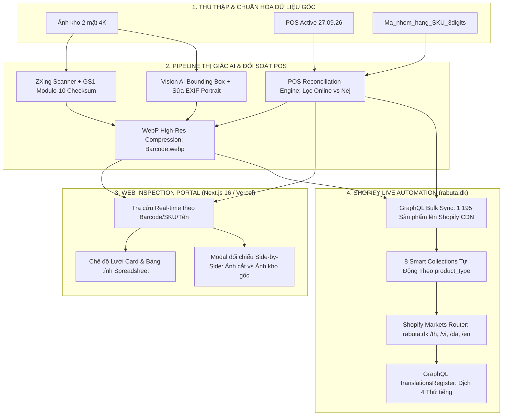

# 🌐 TỔNG HỢP TOÀN DIỆN NGỮ CẢNH DỰ ÁN (PROJECT CONTEXT MASTER)
## DỰ ÁN: RABUTA SHOPIFY & POS CATALOG AUTOMATION SUITE
**Khách hàng:** Anh Thông Tiến Nguyễn (`Rabuta Asian Supermarket`, Đan Mạch)  
**Cửa hàng Trực tuyến:** [https://rabuta.dk](https://rabuta.dk) (`rabuta.myshopify.com`)  
**Cổng Thẩm định Dữ liệu (Web Portal):** [https://web-mu-seven-60.vercel.app](https://web-mu-seven-60.vercel.app)  
**Tài liệu lập ngày:** Tháng 10/2026 | **Tình trạng:** Sẵn sàng cho Giai đoạn Mới  

---

## 1. BẢNG THÔNG TIN ĐỊNH DANH DỰ ÁN (PROJECT IDENTITY)

| Thông tin | Chi tiết cấu hình |
| :--- | :--- |
| **Tên Dự án** | **Rabuta Shopify Catalog Automation & POS Reconciliation** |
| **Hệ thống POS Quầy** | Shopbox POS (Đan Mạch) |
| **Nền tảng E-Commerce** | Shopify Plus / Custom App Admin GraphQL API (`2024-01`) |
| **Tên miền Cửa hàng** | `https://rabuta.dk` (Primary Market: Denmark) |
| **Hạ tầng Web Portal** | Next.js 16.3 / React 19 / Tailwind CSS v4 / Vercel |
| **Ngôn ngữ Hỗ trợ** | 🇩🇰 **Tiếng Đan Mạch (`da`)** — Mặc định (`/`)<br>🇬🇧 **Tiếng Anh (`en`)** — (`/en`)<br>🇻🇳 **Tiếng Việt (`vi`)** — Subfolder (`/vi`)<br>🇹🇭 **Tiếng Thái (`th`)** — Subfolder (`/th`) |
| **Quy mô Danh mục Live** | **1.195 sản phẩm** đang kích hoạt trên Shopify |

---

## 2. NGUỒN GỐC DỮ LIỆU & YÊU CẦU TỪ KHÁCH HÀNG

### 2.1. Nguồn Dữ liệu Khách gửi (`source-import/`)
1. **File POS Active chính thức**: [`27.09.26.POS_ACTIVE_FINAL.xlsx`](file:///d:/Work/shopify/source-import/new_source_from_customer/27.09.26.POS_ACTIVE_FINAL.xlsx) (1.351 sản phẩm đang bán tại cửa hàng Đan Mạch).
2. **File Danh mục Nhóm hàng & Mã SKU**: [`Ma_nhom_hang_SKU_3digits.xlsx`](file:///d:/Work/shopify/source-import/new_source_from_customer/Ma_nhom_hang_SKU_3digits.xlsx) (Quy chuẩn 16 nhóm hàng, tiền tố SKU 3 chữ cái tiếng Đan Mạch và phân loại nhóm `Online` vs `Nej`).
3. **File Tổng hợp Nhập khẩu**: [`Products_imported_to_Shopbox_19_08_26_with_SKU.xlsx`](file:///d:/Work/shopify/source-import/Products_imported_to_Shopbox_19_08_26_with_SKU.xlsx) và [`Ten_hang_nhap.xlsx`](file:///d:/Work/shopify/source-import/Ten_hang_nhap.xlsx) (Dữ liệu từ các nhà phân phối châu Âu: Asropa, Heuschen & Schrouff).
4. **Kho Ảnh Chụp Thực tế**: Hơn 2.000 bức ảnh chụp bao bì 2 mặt (Mặt trước + Mã vạch) tại kho hàng.

### 2.2. Hai Yêu Cầu Cốt Lõi Từ Khách Hàng (Đã phân tích từ tin nhắn)
* **YÊU CẦU 1 (Dữ liệu & Khớp SKU):**
  * Quét trích xuất mã vạch (Barcode) từ ảnh kho.
  * Đối soát 1:1 với mã SKU trong file POS `27.09.26.POS_ACTIVE_FINAL.xlsx`.
  * Phân loại theo bảng 16 nhóm hàng với tiền tố SKU 3 ký tự (`KON-`, `SAU-`, `KRY-`, `SNK-`, `NUD-`, `DRI-`,...).
  * Tự động lọc bỏ các nhóm có cờ `Online = Nej` (hàng đông lạnh `FRO`, cá tươi `FIS`, tôm `REJ` không ship bưu điện xa được).
* **YÊU CẦU 2 (Ảnh Mặt Trước Studio Dọc đưa lên Shopify):**
  * Tách ảnh mặt trước chất lượng cao (HD/Studio).
  * Căn chỉnh sản phẩm thẳng đứng (**Portrait: Chiều cao > Chiều rộng**), loại bỏ lỗi ảnh chụp ngang hoặc méo hình.
  * File ảnh đặt tên chuẩn xác theo mã Barcode (`<barcode>.webp` / `<barcode>.jpg`).
  * Gắn kết nối tương ứng 1:1 với POS SKU và tải lên Shopify CDN.

---

## 3. BỐ CỤC 16 NHÓM HÀNG POS & 8 COLLECTIONS SHOPIFY

| STT | Nhóm hàng POS (Dansk) | Mã SKU | Tên tiếng Việt | Ví dụ SKU | Phân luồng Online (Shopify) |
| :-: | :--- | :---: | :--- | :---: | :--- |
| 1 | **Konserves** | `KON` | Đồ hộp / thực phẩm đóng hộp | `KON-0001` | **Konserves & Kokosmælk** |
| 2 | **Frugt** | `FRU` | Trái cây | `FRU-0001` | **Andre asiatiske varer** |
| 3 | **Krydderier** | `KRY` | Gia vị & Cà ri | `KRY-0001` | **Krydderier & Karry** |
| 4 | **Diverse** | `DIV` | Hàng khác / đa dạng | `DIV-0001` | **Andre asiatiske varer** |
| 5 | **Saucer** | `SAU` | Nước xốt & Nước tương | `SAU-0001` | **Saucer & Sojasauce** |
| 6 | **Mælk** | `MLK` | Sữa | `MLK-0001` | **Andre asiatiske varer** |
| 7 | **Mel** | `MEL` | Bột & Gạo khô | `MEL-0001` | **Ris, Mel & Tørvarer** |
| 8 | **Snack** | `SNK` | Bánh kẹo & Đồ ăn vặt | `SNK-0001` | **Snacks** |
| 9 | *Frostvarer* | `FRO` | *Hàng đông lạnh* | `FRO-0001` | ❌ **Nej** *(Loại trừ khỏi web)* |
| 10 | *Fisk* | `FIS` | *Cá tươi* | `FIS-0001` | ❌ **Nej** *(Loại trừ khỏi web)* |
| 11 | **Grøntsager** | `GRO` | Rau củ | `GRO-0001` | **Andre asiatiske varer** |
| 12 | *Rejer* | `REJ` | *Tôm tươi* | `REJ-0001` | ❌ **Nej** *(Loại trừ khỏi web)* |
| 13 | *Ris* | `RIS` | *Gạo* | `RIS-0001` | ❌ **Nej** *(Gạo bao lớn loại trừ, đồ khô đưa vào Ris & Mel)* |
| 14 | **Drikkevarer** | `DRI` | Đồ uống & Trà | `DRI-0001` | **Drikkevarer & Vin** |
| 15 | **Nudler** | `NUD` | Mì / bún / phở khô | `NUD-0001` | **Nudler** |
| 16 | **Bønner** | `BON` | Các loại đậu | `BON-0001` | **Andre asiatiske varer** |

---

## 4. KIẾN TRÚC GIẢI PHÁP KỸ THUẬT ĐÃ THỰC THI



---

## 5. TRẠNG THÁI HIỆN TẠI TRÊN CỬA HÀNG LIVE (`rabuta.dk`)

* 📊 **Số lượng Sản phẩm**: **1.195 sản phẩm** đang hoạt động đồng bộ.
* 🛡️ **Barcode Checksum**: **1.195 / 1.195 (100.0%)** đạt chuẩn GS1 Modulo-10 (0 lỗi số mũ `E+`).
* 🏷️ **Mã SKU POS**: **1.195 / 1.195 (100.0%)** có mã SKU đúng nhóm hàng.
* 🖼️ **Ảnh Studio Portrait**: **1.194 / 1.195 (99.9%)** có ảnh đứng dọc sắc nét lưu trữ trên Shopify CDN.
* 🗂️ **8 Bộ sưu tập Smart Collections** được dịch đầy đủ 4 thứ tiếng:
  1. `Nudler` (Noodles & Instant Ramen | Mì, Bún & Phở Á Châu | บะหมี่และก๋วยเตี๋ยว)
  2. `Snacks` (Asian Snacks & Sweets | Bánh kẹo & Đồ ăn vặt Á Châu | ขนมและของทานเล่น)
  3. `Saucer & Sojasauce` (Sauces & Soy Sauce | Nước xốt & Nước tương | ซอสปรุงรสและซีอิ๊ว)
  4. `Krydderier & Karry` (Spices & Curry Pastes | Gia vị & Cà ri Á Châu | เครื่องเทศและพริกแกง)
  5. `Drikkevarer & Vin` (Beverages & Tea | Đồ uống, Trà & Giải khát | เครื่องดื่มและชา)
  6. `Konserves & Kokosmælk` (Canned Food & Coconut Milk | Đồ hộp & Nước cốt dừa | อาหารกระป๋องและกะทิ)
  7. `Ris, Mel & Tørvarer` (Rice, Flour & Dry Goods | Gạo, Bột & Đồ khô | ข้าว แป้ง และของแห้ง)
  8. `Andre asiatiske varer` (Other Asian Specialties | Sản phẩm Á Châu khác | สินค้าเอเชียอื่นๆ)
* 🧭 **Menu Điều hướng**: Main Menu & Footer Menu liên kết chuẩn xác sang 4 thứ tiếng.
* 📄 **6 Trang Vận hành & Pháp lý**: Đã dịch tiêu đề và nội dung HTML theo chuẩn EU (GDPR, DAO/PostNord): `om-os`, `kontakt-os`, `levering-fragt`, `handelsbetingelser`, `returpolitik`, `privatlivspolitik`.

---

## 6. CẤU TRÚC THƯ MỤC DỰ ÁN & CÔNG CỤ SẢN XUẤT

```text
d:/Work/shopify/
├── .env                                  # Shopify Admin API App Tokens
├── PROJECT_CONTEXT_MASTER.md             # TÀI LIỆU NGỮ CẢNH TỔNG HỢP DUY NHẤT (SSOT)
├── PROJECT_REQUIREMENTS_AND_SOLUTIONS.md # Đặc tả Yêu cầu Kỹ thuật & Nghiệm thu
├── FUTURE_ROADMAP_AND_FIXES.md           # Danh mục 7 hạng mục cần xử lý & khắc phục trong tương lai
├── README.md                             # Hướng dẫn Vận hành & Kiến trúc Hệ thống
├── ACCEPTANCE_CRITERIA.md                # 15 Tiêu chí Pass/Fail & Definition of Done
│
├── scripts/                              # BỘ CÔNG CỤ SẢN XUẤT CHÍNH
│   ├── sync_full_store_multilingual.py   # Dịch tự động 4 ngôn ngữ cho Danh mục, Menu & Trang
│   ├── sync_to_shopify_live.py           # Bulk Sync sản phẩm lên Shopify Live Store
│   ├── audit_shopify_live_catalog.py     # Kiểm toán chất lượng danh mục 5 chiều
│   ├── setup_full_store_content_and_navigation.py # Triển khai Trang & Menu
│   ├── cleanup_workspace.py              # Dọn dẹp vệ sinh dự án định kỳ
│   └── archive_debug/                    # Lưu trữ các script debug lịch sử
│
├── output/                               # TẬP DỮ LIỆU XUẤT BẢN CHUẨN
│   ├── reconciliation/                   # Báo cáo kiểm toán & Bảng tính đối soát
│   ├── shopify_import_final/             # Danh mục sản phẩm chuẩn hóa
│   ├── g1_delivery/                      # Gói bàn giao G1 & Ảnh studio WebP
│   └── archive_scratch/                  # Dữ liệu nháp đã lưu trữ
│
├── openspec/                             # QUẢN LÝ THAY ĐỔI THEO OPENSPEC
│   ├── config.yaml
│   ├── changes/                          # Các đợt thay đổi (Change proposals)
│   └── specs/                            # Main System Specifications
│
├── src/product_mapper/                   # CORE PYTHON ENGINE (ZXing + Vision AI + Reconciler)
├── web/                                  # CỔNG WEB THẨM ĐỊNH (Next.js 16 / React 19)
├── source-import/                        # DỮ LIỆU GỐC TỪ KHÁCH HÀNG
└── unique_pack1/ & unique_pack2/         # KHO ẢNH CHỤP STUDIO GỐC
```

---

## 7. QUY TRÌNH THỰC THI KHI CÓ YÊU CẦU MỚI TỪ KHÁCH

Khi khách hàng gửi đợt ảnh mới hoặc file POS cập nhật:

```powershell
# BƯỚC 1: Tạo đề xuất thay đổi mới qua OpenSpec (nếu cần theo dõi)
# openspec propose [ten-dot-hang-moi]

# BƯỚC 2: Đồng bộ sản phẩm mới lên Shopify
python scripts/sync_to_shopify_live.py

# BƯỚC 3: Cập nhật bản dịch 4 ngôn ngữ (Danh mục, Menu, Trang)
python scripts/sync_full_store_multilingual.py

# BƯỚC 4: Chạy kiểm toán chất lượng 5 chiều đảm bảo 100% không lỗi
python scripts/audit_shopify_live_catalog.py

# BƯỚC 5: Dọn dẹp tệp tạm giữ vệ sinh workspace
python scripts/cleanup_workspace.py
```
