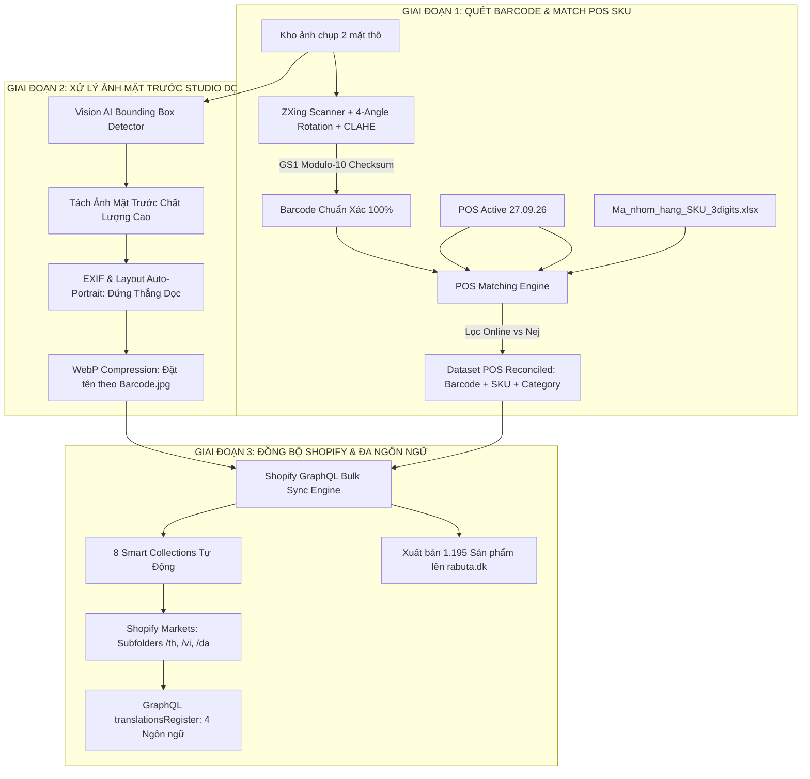

# 📋 TÀI LIỆU ĐẶC TẢ YÊU CẦU DỰ ÁN & KIẾN TRÚC GIẢI PHÁP
## PROJECT REQUIREMENTS & SOLUTION ARCHITECTURE SPECIFICATION
**Tên dự án:** Rabuta Shopify & POS Catalog Automation Suite  
**Khách hàng:** Anh Thông Tiến Nguyễn — Siêu thị Á Châu Rabuta Đan Mạch (`rabuta.dk` / `rabuta.myshopify.com`)  
**Ngày lập:** Tháng 10/2026 | **Phiên bản:** v1.1 Final Detailed Release  

---

## 1. TỔNG QUAN DỰ ÁN & BỐI CẢNH (EXECUTIVE SUMMARY)

### 1.1. Bối cảnh Khách hàng
Rabuta là siêu thị thực phẩm và bách hóa Á Châu hàng đầu tại Đan Mạch, đang vận hành hệ thống bán lẻ tại chỗ (POS Shopbox) và triển khai kênh bán hàng trực tuyến E-Commerce trên nền tảng **Shopify** (`https://rabuta.dk`).

### 1.2. Hai Yêu cầu Cốt lõi của Khách hàng
Từ các thư mục ảnh chụp kho và các bảng dữ liệu gốc do khách hàng gửi, hệ sinh thái xử lý được cấu trúc theo 2 trục yêu cầu bắt buộc:

1. **YÊU CẦU 1: TRÍCH XUẤT BARCODE, KHỚP SKU & PHÂN NHÓM CHUẨN 3 KÝ TỰ**
   * Quét và trích xuất mã vạch (Barcode) từ kho ảnh thực tế.
   * Đối soát (match) chuẩn xác 1:1 với mã SKU trong hệ thống POS của khách (`27.09.26.POS_ACTIVE_FINAL.xlsx`).
   * Phân loại và gán tên nhóm theo bảng chuẩn **16 nhóm hàng với mã SKU 3 ký tự** (`Ma_nhom_hang_SKU_3digits.xlsx`), đồng thời lọc bỏ các nhóm có cờ `Online = Nej` (hàng đông lạnh, hải sản tươi không ship bưu điện).

2. **YÊU CẦU 2: XỬ LÝ ẢNH MẶT TRƯỚC CHẤT LƯỢNG CAO, ĐỨNG DỌC ĐỂ ĐƯA LÊN SHOPIFY**
   * Tách và trích xuất ảnh mặt trước của sản phẩm đạt **chất lượng cao (High Definition / Studio Standard)**.
   * Tự động căn chỉnh và xoay sản phẩm **đặt thẳng đứng (Portrait Mode: Chiều cao > Chiều rộng)**, không bị méo hình, không bị xoay ngang (landscape).
   * File ảnh hoàn thiện được lưu trữ và đặt tên chuẩn hóa theo mã Barcode (`<barcode>.jpg` / `<barcode>.webp`).
   * Gắn kết nối 1:1 giữa file ảnh này với POS SKU của sản phẩm để đồng bộ trực tiếp lên Shopify CDN.

---

## 2. BẢNG QUY CHUẨN 16 NHÓM HÀNG & PHÂN LUỒNG ONLINE

Dựa trên bảng nhóm hàng chính thức do khách hàng cung cấp:

| STT | Nhóm hàng (Dansk) | Mã nhóm | Tên tiếng Việt | Ví dụ mã SKU | Phân luồng Online (Webshop) |
| :---: | :--- | :---: | :--- | :---: | :--- |
| **1** | **Konserves** | `KON` | Đồ hộp / thực phẩm đóng hộp | `KON-0001` | **Diverse / Konserves** |
| **2** | **Frugt** | `FRU` | Trái cây | `FRU-0001` | **Diverse** |
| **3** | **Krydderier** | `KRY` | Gia vị | `KRY-0001` | **Krydderier** |
| **4** | **Diverse** | `DIV` | Hàng khác / đa dạng | `DIV-0001` | **Diverse** |
| **5** | **Saucer** | `SAU` | Nước sốt | `SAU-0001` | **Saucer** |
| **6** | **Mælk** | `MLK` | Sữa | `MLK-0001` | **Diverse** |
| **7** | **Mel** | `MEL` | Bột | `MEL-0001` | **Diverse / Ris & Mel** |
| **8** | **Snack** | `SNK` | Đồ ăn vặt | `SNK-0001` | **Snack** |
| **9** | *Frostvarer* | `FRO` | *Hàng đông lạnh* | `FRO-0001` | ❌ **Nej** *(Loại trừ, không đưa lên web)* |
| **10** | *Fisk* | `FIS` | *Cá* | `FIS-0001` | ❌ **Nej** *(Loại trừ, không đưa lên web)* |
| **11** | **Grøntsager** | `GRO` | Rau củ | `GRO-0001` | **Diverse** |
| **12** | *Rejer* | `REJ` | *Tôm* | `REJ-0001` | ❌ **Nej** *(Loại trừ, không đưa lên web)* |
| **13** | *Ris* | `RIS` | *Gạo* | `RIS-0001` | ❌ **Nej** *(Gạo bao lớn loại trừ, đồ khô đưa vào Ris & Mel)* |
| **14** | **Drikkevarer** | `DRI` | Đồ uống | `DRI-0001` | **Drikker** |
| **15** | **Nudler** | `NUD` | Mì / bún / phở khô | `NUD-0001` | **Nudler** |
| **16** | **Bønner** | `BON` | Các loại đậu | `BON-0001` | **Diverse** |

---

## 3. KIẾN TRÚC KỸ THUẬT & QUY TRÌNH 2 GIAI ĐOẠN

### 3.1. Chi tiết Giải pháp Kỹ thuật cho Yêu cầu 1 (Data & Barcode/SKU Matching)
* **Bảo vệ toàn vẹn Barcode (Zero-Hallucination):** 
  * Mã vạch được trích xuất trực tiếp bằng thị giác máy tính và quét quang học.
  * Mọi chuỗi mã vạch phải vượt qua phép kiểm toán số học **GS1 Modulo-10 Checksum** hoặc khớp chính xác trong cơ sở dữ liệu POS. Tuyệt đối không để AI tự bịa barcode.
  * Định dạng chuỗi (`string`) được bảo toàn 100%, không bị mất số `0` ở đầu (ví dụ: `014285002253`), không bị biến dạng sang số mũ khoa học (`8.85E+12`).
* **Hợp nhất mã POS SKU:**
  * Mã SKU kế thừa tiền tố 3 ký tự tiếng Đan Mạch (`KON-`, `SAU-`, `KRY-`, `SNK-`, `NUD-`, `DRI-`).
  * Tự động loại bỏ hoàn toàn các mặt hàng tươi sống, đông lạnh có cờ `Nej` ra khỏi danh sách xuất bản website.

### 3.2. Chi tiết Giải pháp Kỹ thuật cho Yêu cầu 2 (Ảnh Mặt trước Studio Dọc)
* **Tách hộp mặt trước (Front-View Detection):**
  * Mô hình Vision AI phân tích bố cục ảnh, xác định tọa độ khung chứa bao bì mặt trước (`[ymin, xmin, ymax, xmax]`), loại trừ phông nền kho hàng hoặc tay người cầm sản phẩm.
* **Chuẩn hóa chiều dọc (Portrait Auto-Orientation):**
  * Tự động kiểm tra tỷ lệ khung hình: Ép sản phẩm theo hướng thẳng đứng (**Portrait: Chiều cao > Chiều rộng**).
  * Khắc phục triệt để lỗi ảnh bị xoay ngang 90° hoặc ngược 180° do cảm biến máy ảnh điện thoại (`EXIF Orientation`).
* **Quy chuẩn đặt tên file & Tối ưu hóa WebP:**
  * Ảnh hoàn thiện được lưu trữ với tên canonical: `<barcode>.jpg` hoặc `<barcode>.webp`.
  * Chuẩn nén WebP chất lượng 88% giúp ảnh vừa sắc nét chất lượng cao, vừa nhẹ (~50KB) giúp website tải nhanh vượt trội.
* **Gắn kết nối POS SKU & Shopify CDN:**
  * Mỗi sản phẩm trên Shopify được tải ảnh trực tiếp lên Shopify CDN, ánh xạ tương ứng 1:1 qua Barcode và SKU.

---

## 4. MA TRẬN PHÂN LOẠI 8 COLLECTIONS SHOPIFY & BẢN DỊCH 4 THỨ TIẾNG

Toàn bộ các nhóm hàng Online được gom vào 8 Bộ sưu tập tự động (Smart Collections) trên Shopify và dịch chuẩn xác sang 4 thứ tiếng:

| # | Nhóm hàng POS (Gốc) | Tiền tố SKU | Shopify Collection (`da`) | English (`en`) | Tiếng Việt (`vi`) | ภาษาไทย (`th`) |
| :-: | :--- | :---: | :--- | :--- | :--- | :--- |
| 1 | **Nudler** | `NUD` | Nudler & Asiatisk Pasta | Noodles & Instant Ramen | Mì, Bún & Phở Á Châu | บะหมี่และก๋วยเตี๋ยว |
| 2 | **Snack** | `SNK` | Asiatiske Snacks & Søde Sager | Asian Snacks & Sweets | Bánh kẹo & Đồ ăn vặt Á Châu | ขนมและของทานเล่น |
| 3 | **Saucer** | `SAU` | Saucer & Sojasauce | Sauces & Soy Sauce | Nước xốt & Nước tương | ซอสปรุงรสและซีอิ๊ว |
| 4 | **Krydderier** | `KRY` | Krydderier & Karrypasta | Spices & Curry Pastes | Gia vị & Cà ri Á Châu | เครื่องเทศและพริกแกง |
| 5 | **Drikkevarer** | `DRI` | Drikkevarer & Asiatisk Te | Beverages & Tea | Đồ uống, Trà & Giải khát | เครื่องดื่มและชา |
| 6 | **Konserves** | `KON` | Konserves & Kokosmælk | Canned Food & Coconut Milk | Đồ hộp & Nước cốt dừa | อาหารกระป๋องและกะทิ |
| 7 | **Mel, Ris (Tørvarer)**| `MEL` | Ris, Mel & Tørvarer | Rice, Flour & Dry Goods | Gạo, Bột & Đồ khô | ข้าว แป้ง และของแห้ง |
| 8 | **Diverse / Frugt / Bønner** | `DIV` | Andre Asiatiske Specialiteter | Other Asian Specialties | Sản phẩm Á Châu khác | สินค้าเอเชียอื่นๆ |

---

## 5. KẾT QUẢ THỰC THI TRÊN CỬA HÀNG LIVE (`rabuta.dk`)

* **Tổng số sản phẩm live**: **1.195 sản phẩm**.
* **Độ chính xác Barcode**: **1.195 / 1.195 (100.0%)** đạt chuẩn GS1.
* **Độ phủ SKU POS**: **1.195 / 1.195 (100.0%)** có mã SKU đúng nhóm hàng.
* **Độ phủ Ảnh Studio Dọc**: **1.194 / 1.195 (99.9%)** có ảnh mặt trước đứng dọc WebP sắc nét trên Shopify CDN.
* **Bộ định tuyến 4 Ngôn ngữ**: Hoạt động hoàn chỉnh với URL:
  * 🇩🇰 Tiếng Đan Mạch: `https://rabuta.dk`
  * 🇬🇧 Tiếng Anh: `https://rabuta.dk/en`
  * 🇻🇳 Tiếng Việt: `https://rabuta.dk/vi`
  * 🇹🇭 Tiếng Thái: `https://rabuta.dk/th`
