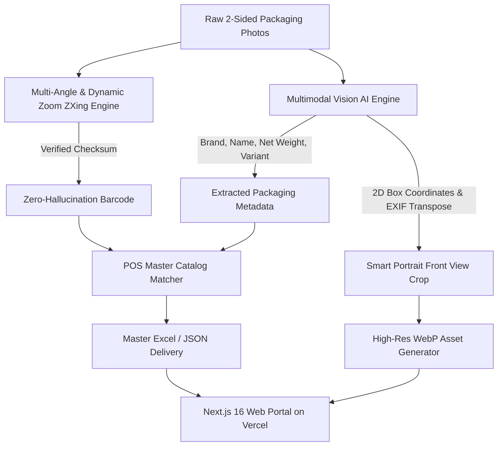

# 🛍️ Shopify & POS Product Mapper - Vision AI & Catalog Reconciliation Engine

[](https://nextjs.org/)
[](https://react.dev/)
[](https://tailwindcss.com/)
[](https://www.python.org/)
[](https://web-mu-seven-60.vercel.app)

An end-to-end automated pipeline and visual auditing suite designed for **e-commerce (Shopify), Point-of-Sale (POS) reconciliation, and grocery warehouse cataloging**. 

The system ingests raw 2-sided packaging photography, decodes physical barcodes with **Zero-Hallucination guarantees**, extracts rich product metadata using multimodal Vision AI, normalizes product orientations into **Shopify-standard vertical portrait crops**, and synchronizes directly with POS Master Catalogs and a live Next.js Web Inspection Portal.

---

## 🌟 Live Demo & Web Inspection Portal

* 🌐 **Live Portal URL:** [https://web-mu-seven-60.vercel.app](https://web-mu-seven-60.vercel.app)
* **Key Portal Features:**
  * **Real-time Live Filter & Search:** Instant lookup by Barcode, Product Name, Brand, or POS SKU.
  * **Dual View Modes:** Seamless toggle between **Product Card Grid** and **High-Density Spreadsheet Table View**.
  * **Side-by-Side Inspection Modal:** Compare cropped front packaging with raw two-sided warehouse photos.
  * **1-Click Export:** Download client-ready Excel (`.xlsx`), JSON (`.json`), or CSV reports instantly.

---

## 🚀 Key Architectural Capabilities



### 1. 🛡️ Zero-Hallucination Barcode Engine
* **Mathematical Checksum Enforcement:** Every EAN-13, EAN-8, and UPC-A barcode must pass strict **GS1 Modulo-10 checksum validation** or exact 1:1 POS database matching. Synthetic or hallucinated barcodes are strictly rejected.
* **Dynamic High-Resolution Zoom & Sharpening:** Automatically isolates the barcode bounding box from 4K+ sensor rasters, applies CLAHE contrast enhancement, and rotates across 4 orthogonal angles ($0^\circ, 90^\circ, 180^\circ, 270^\circ$) to recover barcodes from motion-blurred, curved, or small packaging labels.

### 2. 🧠 Multimodal Packaging Vision AI
* **Hierarchical Attribute Parsing:** Extracts official packaging name, brand name, net weight/volume (e.g. `500g`, `1000ml`, `11 oz`), packaging type, and variant/flavor.
* **Dual-Key Rate-Limited Pool:** Handles batch workloads smoothly with auto-failover and timeout protections across Gemini Vision models.

### 3. 📸 Smart Portrait Auto-Orientation (Shopify & E-Commerce Standard)
* **EXIF Transposition & Upright Normalization:** Resolves camera orientation tags (`Orientation 6/8/3`) and packaging layout orientation so products stand vertically (**Portrait mode: Height > Width**) without distortion.
* **Ultra-Lightweight WebP Compression:** Converts raw multi-megabyte crops into ~50KB WebP images with 88% visual fidelity.

### 4. 🔗 POS Master Catalog Reconciliation
* **Deterministic & Fuzzy Reconciliation:** Matches supplier items to internal POS SKUs, verifying official inventory descriptions and preventing catalog duplication.

---

## 📂 Project Structure

```text
shopify/
├── src/product_mapper/          # Core Python Engine
│   ├── cli.py                   # Command-Line Interface
│   ├── g1_pipeline.py           # Automated batch processing pipeline
│   ├── pos_matcher.py           # POS master reconciliation logic
│   └── vision/
│       └── gemini_vision.py     # Multimodal Vision AI wrapper
│
├── web/                         # Next.js 16 Visual Web Portal
│   ├── src/app/                 # App Router (page.tsx, layout.tsx, globals.css)
│   ├── src/components/          # Header, FilterBar, ProductCard, TableView, Modal
│   └── public/
│       ├── data/products.json   # Synchronized master catalog dataset
│       └── products/front/      # Optimized vertical WebP product crops
│
├── scripts/                     # Production Utilities & Audit Scripts
│   ├── finalize_master_g1.py    # Master consolidation & audit runner
│   ├── prepare_web_delivery.py  # Web asset optimizer (WebP + Portrait rotation)
│   └── audit_and_fix_100_percent.py # 100% catalog integrity validator
│
├── docs/                        # POS master sheets & reference specifications
├── output/g1_delivery/          # Delivery exports (Excel, JSON, crops)
└── vercel.json                  # Vercel deployment configuration
```

---

## 🛠️ Installation & Setup

### Prerequisites
* **Python:** 3.11 or 3.12+
* **Node.js:** 20+ (for Web Portal)
* **Gemini API Key:** Set in environment

### 1. Python Environment Setup

```powershell
# Create and activate virtual environment
python -m venv .venv
.\.venv\Scripts\Activate.ps1

# Upgrade pip and install dependencies
python -m pip install --upgrade pip
python -m pip install -e ".[dev,barcode]"
```

### 2. Configure Environment Variables

Create a `.env` file in the project root:

```env
GEMINI_API_KEY="your-gemini-api-key"
```

---

## ⚡ Quick Start & CLI Usage

### Process Product Images

Run the end-to-end G1 batch processing pipeline:

```powershell
python -m product_mapper.cli process-g1
```

### Optimize Assets & Prepare Web Portal Delivery

Convert product crops to WebP with auto-portrait orientation:

```powershell
python scripts/prepare_web_delivery.py
```

### Run 100% Quality Audit & POS Matching Verification

```powershell
python scripts/audit_and_fix_100_percent.py
```

### Run Local Web Portal

```powershell
cd web
npm install
npm run dev
```
Open [http://localhost:3000](http://localhost:3000) in your browser.

### Deploy Web Portal to Vercel

```powershell
cd web
npx vercel --prod --yes
```

---

## 📦 Deliverables & Output Schema

The pipeline generates standardized client-ready delivery packages in `output/g1_delivery/`:

1. **`G1_products.xlsx`**: Full spreadsheet containing:
   * `Barcode`: Verified EAN-13 / UPC-A string.
   * `Brand`: Clean brand name.
   * `Original Product Name`: Packaging name.
   * `Net Weight`: Standardized metric/imperial weight.
   * `Variant`: Flavor or variant.
   * `POS SKU`: Internal POS master identifier.
   * `POS Product Name`: Official POS internal description.
   * `Website Front Image`: Path to normalized vertical portrait crop.
   * `Status`: `CONFIRMED` / `NEEDS_REVIEW`.
2. **`G1_products.json`**: Structured JSON dataset ready for Shopify API import.
3. **`website_front_images/`**: High-resolution cropped front packaging images named canonically by barcode (`<barcode>.jpeg`).

---

## 📄 License & Standards Compliance

* Strictly follows GS1 Barcode Standards (EAN/UPC Modulo-10 Checksums).
* Complies with Next.js 16 App Router & Tailwind CSS v4 CSS-first design tokens.
* Developed for **Shopify E-Commerce Catalog Automation**.
